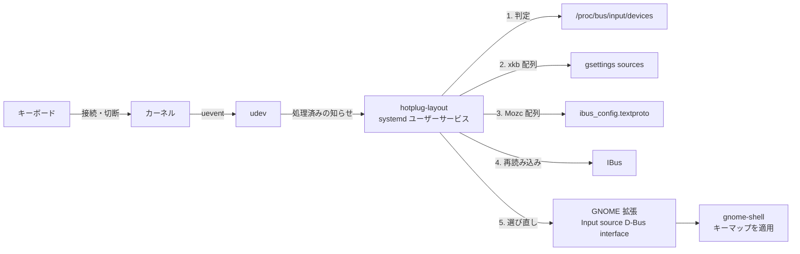
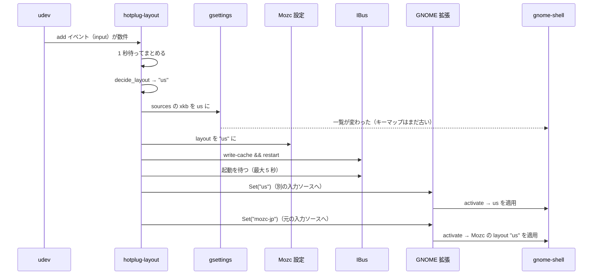

# Hot Layout 設計資料

| 項目 | 内容 |
|---|---|
| 対象 | `bin/hotplug-layout`（v0.1） |
| 対象環境 | Ubuntu 26.04 / GNOME（Wayland）/ IBus + Mozc |
| 状態 | 実装済み・動作確認済み |

## 1. 背景と目的

### 1.1 解決したい問題

ノート PC 内蔵の JIS キーボードと、外付けの US キーボードを併用する。GNOME には「キーボードごとに配列を持たせる」機能がない。そのため、外付けキーボードを繋ぐたびに、配列を手動で切り替える必要がある。

macOS は、キーボードの種類（ANSI / JIS）をキーボードごとに覚えていて、繋ぎ替えても自動で対応する。これに近い体験を GNOME で実現したい。

### 1.2 目標

- 外付けキーボードを繋ぐと、そのキーボードの配列に自動で切り替わる。外すと元の配列に戻る。
- 英数字の入力中（英語(US) などの入力ソース）と、日本語の入力中（Mozc）の両方で、配列が切り替わる。
- 特別な権限（`input` グループなど）を必要としない。
- USB と Bluetooth の両方に対応する。

### 1.3 目標としないこと

- 内蔵と外付けを**同時に**使ったとき、それぞれ刻印どおりに打てるようにすること（理由は 2.3）。
- GNOME 以外のデスクトップ環境、IBus + Mozc 以外の IME への対応。
- キー単位の変換（keyd などの領域）。

## 2. 前提知識

### 2.1 入力ソースと配列

GNOME の入力ソースは、gsettings の `org.gnome.desktop.input-sources sources` に一覧として保存されている。

```
[('ibus', 'mozc-jp'), ('xkb', 'us')]
```

Super+Space は、この一覧の項目を切り替える操作である。項目には2種類あり、配列の持ち方が違う。

| 種類 | 例 | 配列の持ち方 | 設定の場所 |
|---|---|---|---|
| xkb | `('xkb', 'us')` | 項目自体が配列を表す | gsettings の `sources` |
| ibus | `('ibus', 'mozc-jp')` | IME エンジンの属性として持つ | `~/.config/mozc/ibus_config.textproto` の `layout` |

Mozc の設定ファイルは、たとえば次のようになっている。

```
engines {
  name : "mozc-jp"
  layout : "default"
  ...
}
```

### 2.2 配列はいつ適用されるか

GNOME（gnome-shell）は、**入力ソースが選ばれた（activate された）瞬間に**、その入力ソースの配列をキーマップに適用する。

- xkb の項目：その配列（`us` など）を適用する。
- ibus の項目：IBus から取得したエンジンの `layout` を適用する。ただし `layout` が `"default"` のときは、有効な配列名ではないので何も適用しない。その結果、**直前に有効だった配列がそのまま残る**（gnome-shell の `keyboardManager.js` で確認）。

設定を書き換えても、入力ソースが選び直されない限り、キーマップは変わらない。これが本設計で一番重要な制約である。

### 2.3 キーマップは1つしかない

Wayland では、物理キーボードがいくつあっても、入力は1本の論理キーボードにまとめられ、キーマップも1つしかない（「1 seat に 1 keymap」）。アプリには、どの物理キーボードから来た入力かが伝わらない。

このため、「内蔵からの入力は JIS、外付けからの入力は US」と同時に扱うことは、GNOME の仕組みの上ではできない。本ツールは、接続状況に応じて、この1つのキーマップを切り替える方式をとる。

## 3. 全体の構成



| 構成要素 | 役割 |
|---|---|
| `hotplug-layout` | 本体。systemd のユーザーサービスとして、ログインセッション内で常駐する |
| udev | デバイスの接続・切断を知らせる |
| `/proc/bus/input/devices` | 接続中の入力デバイスの一覧。判定に使う |
| gsettings | GNOME の入力ソース一覧（xkb の配列）を書き換える |
| Mozc の設定ファイル | Mozc の配列を書き換える |
| IBus | Mozc の設定を読み直させる |
| GNOME 拡張 | 入力ソースを外部から選べるようにする |

## 4. 処理の流れ

### 4.1 全体のシーケンス

外付けの US キーボードを繋いだときの流れを示す。



### 4.2 ステップ1：接続・切断の監視

```bash
udevadm monitor --udev --subsystem-match=input
```

- `--udev`：udev の処理が終わった後の知らせを受け取る。デバイスファイルの準備ができてから判定するため。
- `--subsystem-match=input`：入力デバイスの知らせだけに絞る。

1台のキーボードでも、接続時には複数のデバイス（キーボード本体、System Control など）とその子デバイスについて、知らせが何件も届く。そこで最初の知らせを受けたら、続く知らせが1秒途切れるまで読み捨ててから、1回だけ判定する。

```bash
udevadm monitor ... | while read -r line; do
  [[ "$line" == UDEV* ]] || continue
  while read -r -t 1 _; do :; done   # 1 秒間何も来なくなるまで読み捨てる
  check
done
```

起動時にも1回 `check_startup` を実行する。ログイン時点ですでに繋がっているキーボードに対応するため。

起動時は、Mozc の設定ファイルがすでに決定した配列と同じでも IBus を再起動し、入力ソースを選び直す（ログは `mozc -> us  (startup, ibus restarted)`）。実行中の IBus/Mozc がファイルと違う配列で動いていることがあるため（例：前に動いていたサービスがファイルを書き換えたあと、IBus の再起動に失敗した、または再起動の途中で止められた）。ホットプラグのときは、変化がなければ何もしない。

### 4.3 ステップ2：配列の判定（`decide_layout`）

`KEYBOARD_RULES` は、「キーボード名の正規表現=配列」を `;` で区切って並べたもの。

```
KEYBOARD_RULES='Keychron K2=us;REALFORCE=jp'
DEFAULT_LAYOUT='jp'
```

1. ルールを上から順に評価する。
2. `/proc/bus/input/devices` に、パターンにマッチする `N: Name=` の行があれば、そのルールの配列を返す。
3. どのルールにも当てはまらなければ `DEFAULT_LAYOUT` を返す。

```bash
grep -qiE "^N: Name=.*(${pattern})" "$INPUT_DEVICES"
```

- 大文字小文字を区別しない（`-i`）。
- パイプでつながず、1つの `grep` でファイルを直接読む。`grep ... | grep -q ...` の形にすると、後段が先に終わったときに前段が SIGPIPE で終了し、`pipefail` によって判定を誤ることがあるため。
- 書式が不正なルール（`=` が無いなど）は、ログに出して無視する。
- 複数のルールに当てはまる場合は、上に書いたものが優先される。US と JIS の外付けを同時に繋いだときの挙動は、ルールの順番で決まる。

### 4.4 ステップ3：xkb 配列の書き換え（`apply_xkb_layout`）

`sources` の最初の xkb の項目だけを書き換える。ibus の項目（Mozc）はそのまま残す。

| 書き換え前 | 書き換え後（us の場合） |
|---|---|
| `[('ibus', 'mozc-jp'), ('xkb', 'jp')]` | `[('ibus', 'mozc-jp'), ('xkb', 'us')]` |
| `[('ibus', 'mozc-jp')]`（xkb なし） | `[('xkb', 'us'), ('ibus', 'mozc-jp')]` |
| `@a(ss) []`（空） | `[('xkb', 'us')]` |

値が変わらないときは書き込まない。udev の知らせはマウスなど無関係なデバイスでも届くため、毎回書き込むと無駄が多い。

この時点で gnome-shell は一覧の変更を検知するが、今の入力ソースは選び直されない。キーマップはまだ古いままである（2.2）。

### 4.5 ステップ4：Mozc 配列の書き換え（`update_mozc_config`）

`ibus_config.textproto` の `layout : "..."` の行を、すべてのエンジン（`mozc-jp`、`mozc-on`、`mozc-off`）について書き換える。

```bash
sed -E 's/^([[:space:]]*layout[[:space:]]*:[[:space:]]*)"[^"]*"/\1"us"/'
```

- 行頭からの `layout :` だけを対象にし、`layout_variant` と `layout_option` の行は変えない。
- 値が変わらないときは書き込まない。
- ホットプラグ時（`apply_mozc_layout`）は、値が変わったときだけ次のステップに進む。起動時（`sync_mozc_layout`）は、変わらなくても進む（4.2）。

**必要な理由**：日本語の入力中は、xkb の配列ではなく Mozc の `layout` が使われる（2.2）。`"default"` のままだと直前の配列が残るので、xkb 側だけを切り替えても、Mozc に切り替えた瞬間に意図しない配列になりうる。そこで、Mozc にも明示的に配列を持たせる。

**副作用**：Mozc 内部では、この値が「かな入力」の対応表の選択にも使われる（`layout != "us"` なら JIS 用）。ローマ字入力には影響しない。

### 4.6 ステップ5：IBus の再起動（`restart_ibus`）

```bash
ibus write-cache && ibus restart
```

- `write-cache`：エンジンの情報（Mozc の設定から作られる）を作り直す。
- `restart`：IBus を再起動し、新しいエンジン情報を読み込ませる。

再起動の直後は IBus が応答しないので、`ibus list-engine` が成功するまで最大5秒待つ（`wait_ibus`）。次のステップで入力ソースを選び直すときに、新しいエンジン情報が使われるようにするためである。

この間、約1秒、日本語入力が使えない。

### 4.7 ステップ6：入力ソースの選び直し（`reactivate`）

ここまでで、gsettings と IBus の情報は新しくなっている。しかし、キーマップに適用されるのは入力ソースが選ばれた瞬間だけなので（2.2）、まだ反映されていない。そこで、今の入力ソースを選び直す。

1. 今の入力ソースを `mru-sources`（GNOME が記録している最近使った入力ソースの一覧）の先頭から取得する。例：`mozc-jp`
2. `sources` から、それ以外の入力ソースを1つ選ぶ。例：`us`
3. GNOME 拡張の D-Bus メソッドで、2 → 1 の順に選ぶ。

```bash
gdbus call --session --dest org.gnome.Shell \
  --object-path /raiden_fumo/InputSources \
  --method raiden_fumo.InputSources.Set us
gdbus call ... --method raiden_fumo.InputSources.Set mozc-jp
```

Super+Space を2回押す操作と同じである。同じ入力ソースを1回選ぶだけでは、gnome-shell が「変更なし」として扱い、適用し直さない可能性があるので、いったん別の入力ソースを経由する。

選び直しは、ステップ3〜5で実際に何かが変わったときだけ行う（`CHANGED` フラグ）。

**GNOME 拡張が必要な理由**：GNOME には、入力ソースを外部から選ぶ公式の手段がない。以前は `gdbus` で gnome-shell に JavaScript を実行させる `Eval` が使えたが、GNOME 41 以降は無効になっている。

## 5. 検討した代替案

| 案 | 内容 | 判断 |
|---|---|---|
| xkb だけを書き換える | Mozc の設定は触らない | **不採用**：Mozc の `"default"` により、日本語入力中は配列が変わらなかった |
| 一覧の変更で選び直しを起こす | ダミーの入力ソースを一時的に追加して戻し、gnome-shell に一覧を作り直させる | **不採用**：実機で試したが、選び直しは起きなかった |
| `mru-sources` を書き換える | 最近使った入力ソースの順番を書き換えて、選び直しを起こす | **不採用**：gnome-shell がこの値の変更を監視している根拠がない |
| Super+Space を偽装する | ydotool などでキー入力を送る | **不採用**：`/dev/uinput` への書き込み権限が必要で、キー入力の偽装が可能になる |
| `gdbus` の `Eval` | gnome-shell に JavaScript を実行させる | **不可**：GNOME 41 以降は無効 |
| udev ルールから直接実行 | 接続時に udev がスクリプトを実行する | **不可**：root 権限でセッションの外で動くため、gsettings や GNOME 拡張を操作できない |
| キー入力の監視（kb-layout-daemon 方式） | 打ったキーボードで判定して切り替える | **不採用**：ユーザーを `input` グループに入れる必要がある（6章） |
| keyd 方式 | 配列を US に固定し、JIS キーボードの入力だけを変換する | **今後の候補**：切り替え自体が不要になるが、JIS 専用キーの扱いなど別の課題がある |
| Mozc を2エンジンに分ける | `mozc-jp`（jp）と `mozc-us`（us）を用意し、選ぶだけにする | **今後の候補**（8章） |

## 6. セキュリティ

本ツールはキー入力を一切読まない。読むのはデバイスの一覧（`/proc/bus/input/devices`、誰でも読める）と、udev の接続・切断の知らせだけである。

キー入力を監視する方式（kb-layout-daemon など）では、`/dev/input/event*` を開くために、ユーザーを `input` グループに入れる必要がある。すると、そのユーザーとして動く**すべてのプログラム**が、全キーボードの生の入力を読めるようになる。

- パスワードや `sudo` のパスワードも読める。ユーザー権限で動く不正なコードが、root 権限を奪う踏み台になる。
- Wayland の「アプリ間でキー入力を盗み見できない」保護を迂回する。

本ツールはこれを避けるため、判定の精度（どちらで打ったか）よりも、権限を増やさないことを優先した。

なお、GNOME 拡張は gnome-shell の中で動き、gnome-shell と同じ権限を持つ。導入する拡張のコードは信頼できるものである必要がある。

## 7. 制約と既知の問題

| 制約 | 原因 |
|---|---|
| 外付けを繋いでいる間は、内蔵キーボードも外付けの配列になる | キーマップが1つで、接続状況だけで判定しているため（2.3） |
| 切り替えのたびとサービスの起動時に約1秒、日本語入力が止まる | IBus の再起動（4.6） |
| 切り替えの瞬間、入力ソースの表示が一瞬変わる | 選び直しで別の入力ソースを経由するため（4.7） |
| Bluetooth キーボードのスリープで、配列が戻る | スリープで切断され、切断として扱われるため |
| Mozc の `layout` が上書きされる | 4.5 の書き換え。インストール時にバックアップを取り、アンインストール時に戻す |
| GNOME 拡張に依存する | GNOME のアップデートで、拡張が動かなくなる可能性がある |

## 8. 今後の改善

### 8.1 Mozc を2エンジンに分ける

`ibus_config.textproto` に、`mozc-jp`（`layout : "jp"`）と `mozc-us`（`layout : "us"`）の2つのエンジンを定義し、両方を入力ソースに登録しておく。切り替えは、GNOME 拡張で `Set mozc-us` を1回呼ぶだけになる。

- Mozc の設定の書き換え、IBus の再起動、選び直しの2回呼び出しが、すべて不要になる。
- 日本語入力が止まらず、表示のちらつきもなくなる。
- 設定ファイルの書き換えがなくなるので、バックアップと復元も不要になる。

### 8.2 Rust での書き直し

8.1 のタイミングで検討する。gsettings を `gio` クレートで型付きのまま扱えるので、sed による文字列処理（4.4、4.5）がなくなる。udev の監視と D-Bus の呼び出しも、外部コマンドを使わずに行える。

## 9. テスト

| 対象 | 方法 |
|---|---|
| ルール判定（4.3） | `tests/test_decide_layout.sh`。`INPUT_DEVICES` で `tests/fixtures/` の偽のデバイス一覧を渡し、選ばれる配列を確かめる |
| Mozc の書き換えと起動時の再起動（4.5〜4.6） | `tests/test_apply_mozc_layout.sh`。`ibus` を偽物に差し替えて、再起動されるかを確かめる |
| 静的解析 | shellcheck |
| 実機での動作 | 手動。USB と Bluetooth で抜き差しする、スリープから復帰する、GNOME 拡張を無効にして `reactivate FAILED` が出るか確かめる |

gsettings、IBus、GNOME 拡張を呼ぶ部分（4.4〜4.7）は、実機の GNOME セッションが必要なので、自動テストの対象外としている。

## 10. 参考

- freedesktop bug 95355：キーボードごとの配列設定の要望（WONTFIX）
- GNOME Bugzilla 738844：キーボードごとの配列設定の要望（OBSOLETE）
- gnome-shell `js/ui/status/keyboard.js`、`js/misc/keyboardManager.js`：入力ソースの選択と配列の適用
- kb-layout-daemon：https://github.com/aydiler/kb-layout-daemon
- keyd：https://github.com/rvaiya/keyd
